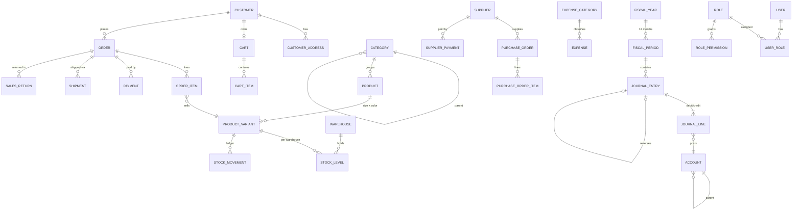
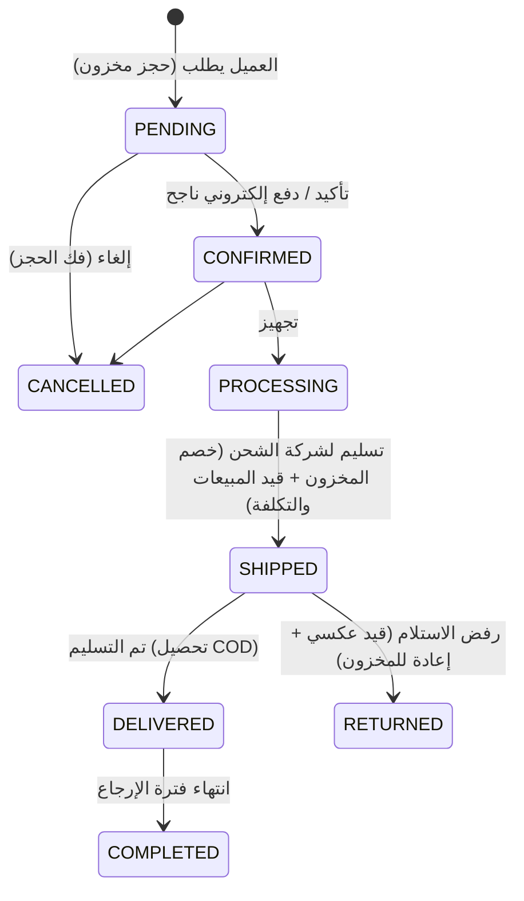

# هيكلية قاعدة البيانات (Database Schema)

المصدر الرسمي للهيكل: [`backend/prisma/schema.prisma`](../backend/prisma/schema.prisma)
قواعد السلامة على مستوى قاعدة البيانات (Triggers / Checks / Views): [`backend/prisma/migrations/*_db_integrity_rules`](../backend/prisma/migrations)

## المبادئ الأساسية

1. **القيد المزدوج (Double-Entry)**: كل مستند مالي (طلب بيع، تحصيل، مرتجع، فاتورة شراء، سداد مورد، مصروف، تسوية مخزون) يولّد **قيد يومية متوازن** (مجموع المدين = مجموع الدائن).
2. **القيود المُرحّلة لا تُعدّل ولا تُحذف**: التصحيح يتم بقيد عكسي (`reversalOfId`). هذا مفروض بـ Triggers في قاعدة البيانات.
3. **الفترات المحاسبية**: لا يمكن الترحيل في فترة مقفلة (`CLOSED` / `LOCKED`).
4. **سجل المخزون Append-only**: `stock_movements` لا يُعدّل؛ الرصيد الحالي في `stock_levels`.
5. **التكلفة بالمتوسط المرجّح** (`ProductVariant.avgCost`)، وتُحفظ تكلفة كل بند لحظة البيع (`OrderItem.unitCost`) لحساب تكلفة البضاعة المباعة وهامش الربح بدقة.
6. **لقطات (Snapshots)**: اسم المنتج والسعر والعنوان تُنسخ داخل الطلب، فلا تتغير الفواتير القديمة إذا تغيّر المنتج.
7. **الأموال `Decimal(14,2)`** والمعرّفات UUID، والأرقام المقروءة (`SO-2026-000123`) من جدول `document_sequences`.

## الوحدات والجداول (49 جدولاً)

| الوحدة | الجداول |
|---|---|
| **الهوية والصلاحيات** | `users` (موظفو تطبيق الإدارة)، `roles`، `permissions`، `user_roles`، `role_permissions`، `customers` (عملاء التطبيق)، `customer_addresses`، `devices` (FCM)، `refresh_tokens` |
| **الكتالوج** | `categories` (شجرية)، `products`، `product_variants` (مقاس × لون، SKU، باركود، التكلفة)، `product_images`، `product_reviews`، `wishlist_items`، `tax_rates` |
| **المخزون** | `warehouses`، `stock_levels`، `stock_movements`، `stock_counts`، `stock_count_items` |
| **المبيعات** | `carts`، `cart_items`، `coupons`، `coupon_usages`، `shipping_zones`، `orders`، `order_items`، `order_status_history`، `payments`، `shipments`، `courier_settlements`، `sales_returns`، `sales_return_items` |
| **المشتريات** | `suppliers`، `purchase_orders`، `purchase_order_items`، `supplier_payments` |
| **المصروفات** | `expense_categories`، `expenses` |
| **المحاسبة العامة** | `accounts` (دليل الحسابات)، `fiscal_years`، `fiscal_periods`، `journal_entries`، `journal_lines` |
| **النظام** | `document_sequences`، `settings`، `notifications`، `audit_logs` |

## مخطط العلاقات (ERD) — الجزء الأساسي

ربط المستندات بالقيود يتم عبر `journal_entries.source_type + source_id` (مثلاً `SALES_ORDER` + id الطلب).

## دليل الحسابات الافتراضي (يُنشأ بالـ seed)

| الكود | الحساب | المفتاح النظامي |
|---|---|---|
| 1101 | الخزينة الرئيسية | `CASH` |
| 1102 | البنك | `BANK` |
| 1103 | المحافظ الإلكترونية | `WALLET` |
| 1104 | مستحقات بوابات الدفع | `GATEWAY_CLEARING` |
| 1105 | مستحقات شركات الشحن (COD) | `COD_RECEIVABLE` |
| 1110 | العملاء | `AR` |
| 1120 | المخزون | `INVENTORY` |
| 1130 | ضريبة القيمة المضافة - مدخلات | `VAT_INPUT` |
| 2101 | الموردون | `AP` |
| 2102 | ضريبة القيمة المضافة - مخرجات | `VAT_OUTPUT` |
| 3101 / 3102 | رأس المال / الأرباح المحتجزة | `CAPITAL` / `RETAINED_EARNINGS` |
| 4101 | إيرادات المبيعات | `SALES` |
| 4102 / 4103 | مردودات / خصومات المبيعات | `SALES_RETURNS` / `SALES_DISCOUNTS` |
| 4104 | إيرادات الشحن | `SHIPPING_INCOME` |
| 5101 | تكلفة البضاعة المباعة | `COGS` |
| 5102 | تسويات المخزون | `INVENTORY_ADJUSTMENT` |
| 52xx | المصروفات التشغيلية (رواتب، إيجار، تسويق، شحن، عمولات دفع ...) | |

كود الخادم يصل للحسابات بالمفتاح `systemKey` وليس بالكود، فيمكن للمحاسب إعادة ترقيم الدليل بحرية.

## قواعد الترحيل التلقائي (Posting Rules)

كل القيود التالية مُطبّقة ومُختبرة بالأرقام في اختبارات e2e.

| الحدث | مدين | دائن |
|---|---|---|
| **شحن طلب بيع** (الاعتراف بالإيراد) | العملاء (AR) بإجمالي الطلب خصومات المبيعات | إيرادات المبيعات ضريبة مخرجات إيرادات الشحن |
| ↳ تكلفة البضاعة (نفس القيد) | تكلفة البضاعة المباعة | المخزون |
| ↳ تسوية الدفع المسبق (نفس القيد) | دفعات مقدمة من العملاء | العملاء (AR) |
| **دفع قبل الشحن** | الخزينة / البنك / المحفظة / بوابة الدفع | دفعات مقدمة من العملاء |
| **تحصيل بعد الشحن / عند التسليم (COD)** | الخزينة / البنك / مستحقات شركات الشحن | العملاء (AR) |
| **استرداد قبل الشحن أو بعد رفض الاستلام** | دفعات مقدمة من العملاء | الخزينة / البنك / بوابة الدفع |
| **رفض العميل الاستلام** | قيد عكسي كامل لقيد الشحن + إعادة البضاعة للمخزون بتكلفتها | |
| **استلام مرتجع مبيعات** | مردودات المبيعات (الصافي) + ضريبة مخرجات المخزون (للقطع الصالحة فقط) | العملاء (AR) تكلفة البضاعة المباعة |
| **رد قيمة المرتجع** | العملاء (AR) | الخزينة / البنك |
| **تسوية شركة الشحن لمبالغ COD** | البنك (الصافي) + مصروفات الشحن (العمولة) | مستحقات شركات الشحن |
| **استلام بضاعة من مورد** (جزئي أو كلي) | المخزون (السعر + نصيبه من الشحن) + ضريبة مدخلات | الموردون (AP) |
| **سداد مورد** | الموردون (AP) | الخزينة / البنك |
| **اعتماد مصروف مدفوع** | حساب المصروف (من تصنيفه) + ضريبة مدخلات | الخزينة / البنك |
| **اعتماد فاتورة مصروف غير مدفوعة** | حساب المصروف + ضريبة مدخلات | مصروفات مستحقة |
| **سداد مصروف مستحق** | مصروفات مستحقة | الخزينة / البنك |
| **إلغاء مصروف معتمد** | قيد عكسي لقيد الاعتماد | |
| **رصيد افتتاحي للمخزون** | المخزون | أرصدة افتتاحية |
| **عجز جرد / تالف** | تسويات المخزون | المخزون |
| **زيادة جرد** | المخزون | تسويات المخزون |
| **تحويل بين المخازن** | لا يوجد قيد (القيمة لم تتغير) | |

**منع فروق التقريب:** الاستلام الجزئي من المورد والمرتجعات الجزئية تُحسب تراكمياً. كل عملية تُرحّل الفرق بين
"الإجمالي حتى الآن" و"الإجمالي السابق"، فيصل أمر الشراء المستلم بالكامل إلى إجماليه بالضبط، ويُرد
البند المرتجع بالكامل بقيمته الأصلية بالضبط. في الاختبارات يتطابق رصيد حساب المخزون مع قيمة المخزون الفعلية بفرق 0.00.

## الحماية على مستوى قاعدة البيانات (مُختبرة)

| القاعدة | التنفيذ |
|---|---|
| السطر إما مدين أو دائن، وبقيم موجبة | `CHECK journal_lines_one_side_chk` |
| القيد يُنشأ كمسودة فقط | Trigger `journal_entry_insert_guard` |
| الترحيل يتطلب: توازن، سطرين على الأقل، فترة مفتوحة، تاريخ داخل الفترة | Trigger `journal_entry_status_guard` |
| القيد المُرحّل لا يُعدّل ولا يُحذف (المسموح فقط POSTED → REVERSED) | Triggers على `journal_entries` و `journal_lines` |
| لا ترحيل على حساب رئيسي (تجميعي) أو غير نشط | Trigger `journal_line_account_guard` |
| المخزون لا يصبح سالباً، والمحجوز ≤ المتاح | `CHECK stock_levels_non_negative_chk` |
| حركات المخزون لا تُعدّل | Trigger `stock_movement_append_only` |
| عنوان افتراضي واحد لكل عميل، مخزن افتراضي واحد | Partial unique indexes |
| ميزان المراجعة | View `v_trial_balance` |
| المتاح من كل صنف وتنبيه نقص المخزون | View `v_variant_availability` |

## دورة حياة الطلب

