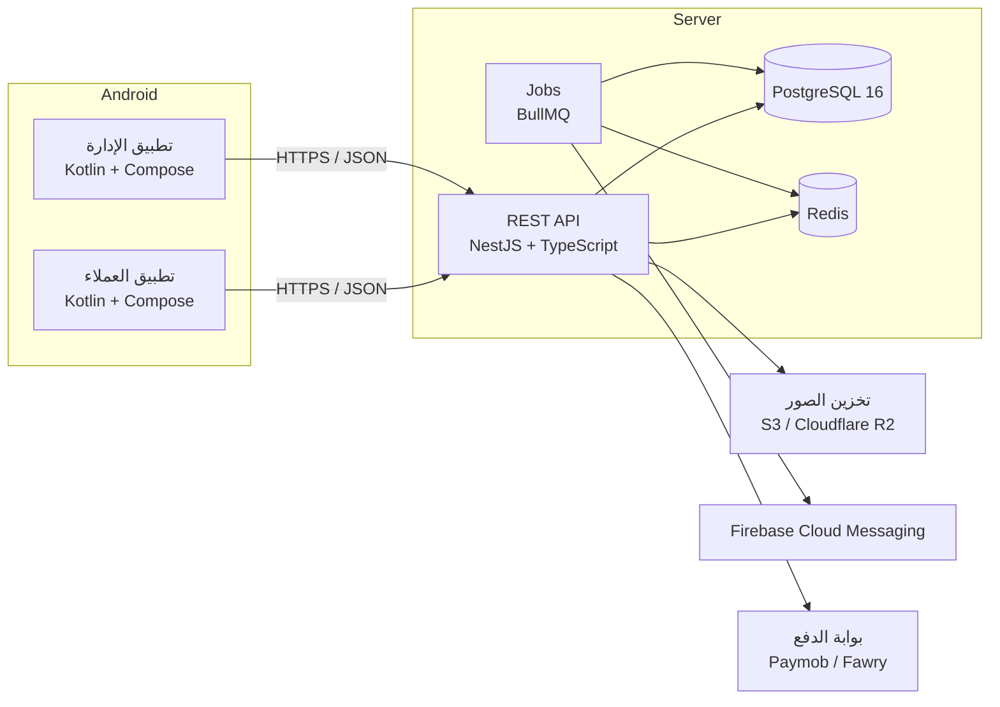

# التقنيات المختارة للمشروع (Tech Stack)

## نظرة عامة على المعمارية



خادم واحد (Backend) هو المصدر الوحيد للحقيقة، والتطبيقان يتعاملان معه عبر REST API.
كل العمليات المحاسبية (القيود، التكلفة، المخزون) تتم على الخادم داخل Transactions — التطبيقات لا تحسب أي أرقام مالية بنفسها.

## 1. الخادم (Backend)

| المكون | الاختيار | السبب |
|---|---|---|
| اللغة | **TypeScript** (Node.js 22 LTS) | لغة واحدة نوعية (Typed)، مكتبات ضخمة، سهولة التوظيف |
| الإطار | **NestJS 11** | معمارية Modules واضحة تناسب أنظمة ERP، Guards للصلاحيات، Swagger تلقائي |
| قاعدة البيانات | **PostgreSQL 16** | ACID كامل، `NUMERIC` دقيق للأموال، Triggers وCheck Constraints لحماية القيد المزدوج، JSONB |
| ORM | **Prisma 7** | Schema واحد مقروء، Migrations، أنواع TypeScript مولّدة تلقائياً |
| Cache / Queues | **Redis 7 + BullMQ** | الإشعارات، إعادة حساب التقارير، مهام مجدولة (إقفال الفترات، تنبيهات المخزون) |
| المصادقة | **JWT** (Access 15 دقيقة + Refresh Token مُدوّر ومُخزّن كـ Hash) | مناسب لتطبيقات الموبايل |
| كلمات المرور | **Argon2id** / scrypt | معيار حديث وآمن |
| التحقق من المدخلات | `class-validator` / `zod` | |
| توثيق الـ API | **OpenAPI (Swagger)** | يُستخدم لتوليد كود الـ API client في أندرويد تلقائياً |
| الملفات والصور | **S3-compatible** (Cloudflare R2 أو AWS S3) + CDN | |
| الإشعارات | **Firebase Cloud Messaging** | |
| التقارير PDF | `pdfmake` / Puppeteer | فواتير، كشوف حساب |

## 2. تطبيقات أندرويد

مشروع Gradle واحد متعدد الوحدات (Multi-module) يحتوي التطبيقين ويشاركان كوداً مشتركاً:

```
android/
├── app-customer/        تطبيق العملاء (التسوق، السلة، الطلبات، الدفع)
├── app-admin/           تطبيق الإدارة (المبيعات، المخزون، المحاسبة، التقارير)
├── core/network/        Retrofit + OkHttp + معالجة التوكن
├── core/data/           Repositories + Room (cache offline)
├── core/model/          نماذج البيانات المشتركة
├── core/designsystem/   الثيم، الخطوط العربية، دعم RTL، المكونات المشتركة
└── core/common/         أدوات عامة (تنسيق العملة والتاريخ ...)
```

| المكون | الاختيار |
|---|---|
| اللغة | **Kotlin 2.x** |
| الواجهة | **Jetpack Compose + Material 3** (دعم RTL كامل) |
| المعمارية | **MVVM + Clean Architecture** + Unidirectional Data Flow |
| حقن الاعتماديات | **Hilt** |
| الشبكة | **Retrofit + OkHttp + Kotlinx Serialization** |
| التخزين المحلي | **Room** (cache) + **DataStore** (الإعدادات والتوكن مشفّر) |
| التنقل | Navigation Compose |
| الصور | **Coil** |
| الصفحات الطويلة | Paging 3 |
| الإشعارات | Firebase Messaging |
| الرسوم البيانية (تطبيق الإدارة) | Vico |
| الماسح الضوئي (باركود المخزون) | ML Kit Barcode Scanning |
| الحد الأدنى | Android 8.0 (API 26) |

## 3. البنية التحتية والتشغيل

| المكون | الاختيار |
|---|---|
| الحاويات | **Docker + Docker Compose** (تطوير) |
| الاستضافة | VPS (Hetzner / DigitalOcean) أو خدمة مُدارة لـ PostgreSQL |
| CI/CD | **GitHub Actions** — اختبار، بناء Docker image، بناء APK/AAB |
| النسخ الاحتياطي | `pg_dump` يومي + WAL archiving للاستعادة لنقطة زمنية |
| المراقبة | Sentry (أخطاء الخادم والتطبيقات) + سجلات منظّمة (pino) |

## 4. لماذا PostgreSQL بالتحديد لنظام محاسبي؟

- **`NUMERIC(14,2)`**: لا أخطاء تقريب كالتي تحدث مع `float`.
- **Transactions حقيقية**: الطلب + حركة المخزون + القيد المحاسبي تُحفظ معاً أو تُلغى معاً.
- **Triggers**: قاعدة البيانات نفسها ترفض أي قيد غير متوازن، أو تعديل قيد مُرحّل، أو الترحيل في فترة مقفلة — حتى لو حدث خطأ في كود التطبيق.
- **Views**: ميزان المراجعة وتوفر المخزون محسوبة مباشرة من السجلات.
